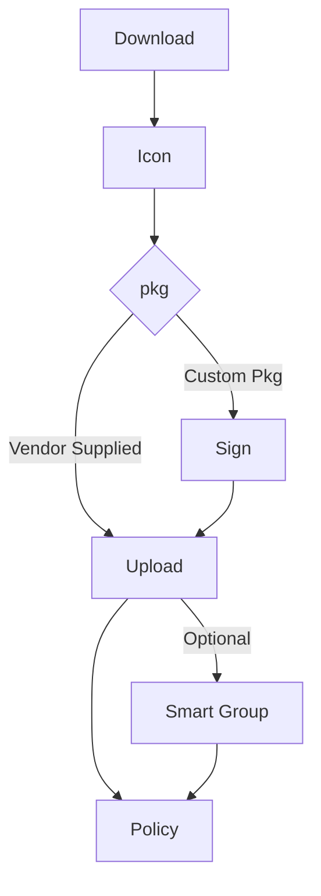

# franton-recipes

Recipes for Autopkg - https://github.com/autopkg

## Description

This repo is meant as a self contained repo where all the recipes and shared processors reside under one roof. I unfortunately have requirements that I must own the entire stack. I don't make the rules.

### Recipe Overview

The recipes here are comprised of the following and are executed in the following order:

* download recipe - This merely downloads the .zip / .dmg / .pkg from the respective vendor.
* icon recipe - Takes the download output, versions it and processes the app through [SAP's macOS icon generator](https://github.com/SAP/macOS-icon-generator) tool and places into a versioned folder.
* pkg recipe - Takes either the download output or the decompressed output from the icon recipe and turns it into a deployable pkg. Some recipes have big custom scripting.
* sign recipe - **Optional**. Use this if you have a requirement for signed final pkg generation.

It is ***highly recommended*** that you generate an autopkg override of the stage you require, just so you can customize the internal variable names. Most of these recipes will not run unless you do this!

(The idea for icon and sign recipes came from [Rich Trouton's blog](https://derflounder.wordpress.com/2021/07/30/signing-autopkg-built-packages-using-a-sign-recipe/) and I give attribution and thanks.)

#### Jamf Specific Recipes

* upload recipe - This takes all the output from previous stages, signed pkg, icon and uploads into Jamf. Special shoutout to [smithjw](https://smithjw.me/) for the idea of retry logic. It also removes n-3 and older pkg files from Jamf.
* policy recipe - We have the package and icon in Jamf. This first creates any missing categories, then (with a few recipe exceptions) creates or modifies a Self Service policy for the app.

By making an override of the final policy recipe, you can have a complete lifecycle of the application.



(Big thanks also go to [graham pugh](https://grahamrpugh.com/about.html) for all the Jamf Uploader processor work.

#### Folder Structure

```
franton-recipes/
├── <App>/	                                # Per-app folders
│   ├── <App>.download.recipe.yaml          # Download recipe
│   ├── <App>.icon.recipe.yaml              # Generate icon file from download recipe
│   ├── <App>.pkg.recipe.yaml               # Generate a versioned installer pkg recipe
│   ├── <App>.sign.recipe.yaml              # (OPTIONAL) Custom package signing
│   ├── <App>.upload.jamf.recipe.yaml       # Upload icon and pkg recipe. Prune older than two versions.
│   ├── <App>.smartgroup.jamf.recipe.yaml   # Smart group recipe (OPTIONAL)
│   ├── <App>.policies.jamf.recipe.yaml     # Self Service and Standard policy recipe
│   ├── <App>.(jsm/SelfService)Template.xml # Jamf Setup Manager / Self Service policy template
├── SharedProcessors/                       # Shared Custom processors
```

### Shared Processors

Please see the README.md file in the SharedProcessors folder for author and copyright information. All shared processors are copyright of their respective authors.

IconGenerator.py is written partly by myself and requires [SAP macOS icon generator](https://github.com/SAP/macOS-icon-generator) to be installed on the system to run. Details on switches can be found in the code itself but the defaults are reasonably sensible.

S3XMLParser.py is my own effort, inspired by information obtained from Robert Hammen on GlobalProtect's s3 bucket. It takes the URL of a public S3 bucket, parses the xml of contents for both a filename and a version number. GlobalProtect likes 6.2.8-122/GlobalProtect.pkg for example, so I specify GlobalProtect.pkg for the name and 6.2.8 for the version. The processor auto finds the latest version from that.
